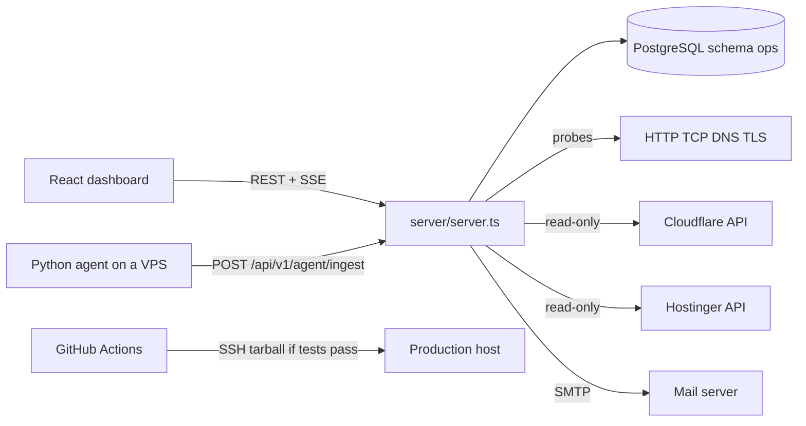

# Scholario Ops — Codebase audit and future scope

Audit date: 17 October 2026.  
Scope: the repository at `d:\ByLine-Koti\Scholario Ops`, branch `17/10` (HEAD `6fb139f`).  
This document records what the code does. It does not change application behaviour.

**Facts** are what the files and previous test runs show. **Recommendations** are separate and are not implemented.

## Status after this audit (26–27 October 2026)

The sections below are the 17 October record. This has landed since then:

- The agent update script is `buildUpdater` in `server/agent.ts`. It keeps the installed config and restores `agent.py.bak` when the new process does not report. The loose `agent-3.3.1.py` file has been removed. Setup is the only copy.
- Cloudflare sync is an error when the token cannot list zones, including when the account load-balancer list is empty.
- CI posts the deployment after a success, a rollback, or a failure. Missing `OPS_REPORT_URL`, `OPS_DEPLOY_REPORT_TOKEN`, or `OPS_APPLICATION_CODE` fails that step.
- A HARD dependency with a real check changes application status. A Hostinger connection can be deleted.
- DR overall is READY, DEGRADED, NOT READY, or UNKNOWN. Core checks are PASS, FAIL, WARNING, or UNKNOWN. The UI no longer treats `PARTIALLY_READY` as a current overall.
- Load is a capacity type (warning 1 per core, critical 2). An incident waits for 5 sustained minutes. A missing core count stays unknown and does not count as a healthy load.
- Overview lists every application (`ApplicationStatusPanel`); ICT is not the only panel. PRD-only apps are valid (DR optional; new apps do not auto-pick DR). Two applications may share one server (Setup shows “Used by”). Live operator steps: `docs/PRODUCTION_LIVE_CHECKLIST.md`.

---

## 1. Executive summary

Scholario Ops is a single Node process that serves a React dashboard and a REST API, with PostgreSQL as the store. A Python agent on each VPS posts telemetry. The server probes URLs, ports, DNS and certificates on a one-second scheduler. Cloudflare Load Balancing and Hostinger are read-only API clients. Incidents, escalation and email are implemented and covered by automated tests.

The product is built around a **PRD server plus an optional DR server**, monitors attached to an application, and a separate dependency register. It can hold many applications. It does not yet model 9–20 applications that each have a different shape (Workers, Redis, shared databases, queues) and then compute health from that graph.

There is **no `worker.js`** and **no automatic agent updater**. The dashboard marks an agent outdated by comparing the **last accepted report** with the version compiled into the running server (`server/agent.ts`, constant `AGENT_VERSION`, currently `3.3.1`). Copying `agent-3.3.1.py` onto a VPS does not by itself change the dashboard.

This audit did **not** connect to production, did **not** open the production database, and did **not** re-run the full test suite. The last GitHub Actions run on `main` (run 39018883468, commit `63fa166`) failed its test job, so the production deploy step was skipped. A later local re-run of the four files that contained those five failures passed after fixes that are on this branch.

Uncommitted work on this machine, not part of the committed audit baseline: edits in `src/components/applications/ApplicationsView.tsx` and `src/components/setup/SetupView.tsx`, plus an untracked `agent-3.3.1.py`.

---

## 2. Technology stack and architecture

Verified from `package.json`, `server/server.ts`, `src/App.tsx` and `README.md`.

| Layer | What it is |
|---|---|
| UI | React 19, Vite, Tailwind 4, React Router 7. No Redux. Live state is `OpsContext`. |
| API | Express in `server/routes.ts`. One process also serves the built UI. |
| Data | PostgreSQL (`pg`). Schema name from `DB_SCHEMA` (default `ops`). Migrations in `server/migrations/`. |
| Realtime | Server-Sent Events at `GET /api/v1/realtime/stream`, ticket from `POST /api/v1/realtime/ticket`. |
| Agent | Python script generated by `buildInstaller()` in `server/agent.ts`. |
| Mail | nodemailer. SMTP settings from the server environment, never sent to the browser. |
| Jobs | `setInterval` inside the same process (`server/server.ts` `startBackgroundWork`, `server/engine.ts` `startEngine`). No Redis queue, no separate worker process. |
| CI | GitHub Actions `.github/workflows/ci-cd.yml`: lint, build, `npm test` against a throw-away Postgres, then SSH deploy of a tarball when tests pass on `main`. |

---

## 3. Repository structure and how a request runs

| Path | Role |
|---|---|
| `src/` | Dashboard. Routes are in `src/App.tsx`. Data loading is `src/context/OpsContext.tsx` and `src/services/api.ts`. |
| `server/` | API, probe engine, alerts, notifications, Cloudflare, Hostinger, auth, store. |
| `server/migrations/` | SQL 001 through 009. |
| `server/agent.ts` | Agent source template and `AGENT_VERSION`. |
| `deploy/` | `release.sh`, `backup-db.sh`, `verify-backup.sh`, PM2 ecosystem, watchdog. |
| `tests/` | 29 Node test files. They use a disposable database name `scholario_ops_ui_test`. |
| `docs/` | CI, notifications, branch protection. Older `.docx` files are historical until checked against this code. |

**Login.** `POST /api/auth/login` (`server/auth.ts`) checks the user in PostgreSQL, sets an httpOnly cookie, and returns a safe user object. Roles are viewer, operator, it_administrator, super_admin. `requireRole` on each route is the real gate. The UI mirror is `canDo()` in `src/context/AuthContext.tsx`.

**Dashboard load.** After login, the UI calls `GET /api/v1/bootstrap`. That returns servers, applications, monitors, incidents and channels from memory, which `server/store.ts` loaded from PostgreSQL at startup. Later changes are saved back with `persist()`.

**A monitor check.** `startEngine()` runs `schedulerTick` every second (`server/engine.ts`). Due monitors call `executeCheck` (`server/probes.ts` for HTTP, TCP, DNS, TLS, heartbeat). The result is classified UP, DEGRADED, DOWN, TIMEOUT, DNS_ERROR, TLS_ERROR or CONNECTION_ERROR, stored in `check_results`, and can open an incident through `openIncidentForMonitor` then `notifyIncident`.

**An agent report.** The VPS posts JSON to `POST /api/v1/agent/ingest` with `Authorization: Bearer <per-server token>`. `agentServer()` matches the token. `ingestAgentReport()` writes CPU, disk, services, databases and `agentVersion` onto that server row.

---

## 4. Feature completion matrix

Status words:

- **Complete** — the screen and the API both work on stored or live data, and tests cover the main path.
- **Partial** — a real path exists, but an important part is missing, manual, or not tied to health.
- **Missing** — no implementation in this repository.
- **Needs verification** — the code is there; this audit did not watch it run against the real service.

| Feature | Status | Evidence | Remaining work |
|---|---|---|---|
| Dashboard and overview | Complete (code) | `OverviewView` + `ApplicationStatusPanel` list every application; DR cards only when configured. | Confirm production numbers on the live site ([docs/PRODUCTION_LIVE_CHECKLIST.md](PRODUCTION_LIVE_CHECKLIST.md)). |
| Application inventory | Complete (PRD/DR model) | CRUD + `AppEditor`. PRD-only and shared PRD servers supported; DR optional; auto-failover defaults off. | More than two servers / Redis / queue as child resources → §12 (later). |
| Infrastructure inventory | Complete (servers) | Servers CRUD + Hostinger sync by IP; shared IP not overwritten. | First-class Redis / queue / Worker rows → §12 (later). |
| Monitoring and probes | Complete | `server/probes.ts`, `executeCheck` and `schedulerTick` in `server/engine.ts`. Results in `check_results`. Tests: `tests/monitoring.test.ts`. | Confirm the production process is actually running the scheduler (`/api/health` reports `schedulerAgeMs`). |
| Telemetry agent | Complete (code) | Ingest, install, and `GET /api/v1/agent/update/:serverId` (`buildUpdater` with config keep + rollback). Setup shows Install and Update commands. | Operator must run Update on each VPS ([PRODUCTION_LIVE_CHECKLIST.md](PRODUCTION_LIVE_CHECKLIST.md)). |
| Incidents | Complete | Open, acknowledge, assign, note, resolve: `server/routes.ts` around `/v1/incidents`. Auto-open from monitors and `server/alerts.ts`. UI: `src/components/incidents/IncidentsView.tsx`. | Production paging depends on channels, quiet hours and SMTP. Inbox delivery was not checked. |
| Alerts and email | Complete (code) | `notifyIncident`, HTML mail, mock refused in production. Tests cover escalation / grouping / subject. | Prove inbox delivery on the live SMTP / channel ([PRODUCTION_LIVE_CHECKLIST.md](PRODUCTION_LIVE_CHECKLIST.md)). |
| Escalation and quiet hours | Complete | `server/notify.ts` `escalateStep`, `src/lib/quietHours.ts`. Tests: `tests/escalation.test.ts`, `tests/quiet-hours.test.ts`. | Operators must save policies in the UI or the defaults apply. |
| Disaster recovery readiness | Complete (code) | `server/readiness.ts`. PRD-only apps are not scored NOT_READY for lacking DR. | Confirm live PRD/DR checks after agents and URLs are wired. |
| Failover | Complete (code, safe default) | DNS failover (super_admin); LB apps use decision log; auto-failover off unless configured and only for direct DNS. | Keep auto-failover off until restore drill + zone match ([PRODUCTION_LIVE_CHECKLIST.md](PRODUCTION_LIVE_CHECKLIST.md)). |
| Backups | Complete (code, status only) | App backup reports + Ops `deploy/backup-db.sh` / `verify-backup.sh`. | Product records restore results; it does not execute restores (by design). |
| Dependencies | Complete (code) | Register + HARD/SOFT links. `recomputeApplication` applies HARD (can CRITICAL) and SOFT (can WARNING) when a real check exists. Status line cites cause via `statusCause`. | — |
| Cloudflare Load Balancing | Complete (code) | Read-only pool sync; empty/unreadable zones surface a clear token error. Tests: `tests/loadbalancer.test.ts`. | Live token must include Zone Read for the real zone. |
| Cloudflare DNS zones | Complete (code) | `syncCloudflare` when token set; permission gaps are errors, not silent empty data. | Same live token scope as LB. |
| Cloudflare Workers | Partial | Worker routing + `POST /api/v1/worker-events` for request/error counts. No first-class Worker resource table / `worker.js` in-repo. | Add a Worker resource only when a real Worker must be inventoried (§12). |
| Hostinger | Complete (code) | Connections CRUD including delete; sync by IP; shared IP not overwritten on purpose. | — |
| Deployments | Complete (code) | Report API + UI; CI posts SUCCESS / ROLLED_BACK / FAILED after deploy. | Other products still report via their own pipelines / tokens. |
| Runbooks | Complete (code, checklist) | CRUD and step checkboxes. | Does not SSH/execute on a VPS (by design). |
| Maintenance windows | Complete (code) | Create, edit, complete, delete; alerts paused for scope. | — |
| Audit log | Complete | `audit()` writes rows. UI: `src/components/admin/AuditLogsView.tsx`. | Retention prune already configured (`AUDIT_RETENTION_ENTRIES`). |
| Reports and reliability | Complete (code) | Insights, uptime/daily/summary, SLO/disk alerts; empty history stays unknown. | Needs live metric history for forecasts. |
| Authentication | Complete | Login, refresh, logout, change password, roles, optional OIDC SSO when configured. | Delete `initial-admin-password.txt` after first login. |
| Users | Complete | `src/components/admin/UsersView.tsx`. Create, reset password, delete. | Super-admin is required to delete a user. |
| Notifications channels | Complete | Teams, webhook, email, PagerDuty. Edit and delete for `it_administrator`. Delivery log and resend. | Email needs `PUBLIC_URL` for the incident button. |
| Agent version display | Complete (code) | Outdated badge + Setup Update command. Tests in `tests/telemetry.test.ts` / agent-update. | Verify on live VPSs after Update. |
| CI/CD | Complete (code) | Workflow tests then deploys; deploy reports into Ops. | Merge latest branch to `main` so production receives it. |
| Background scheduler | Complete | `schedulerTick` every 1s; alerts every 60s; Cloudflare and Hostinger on their own intervals. Leader lock in `server/leader.ts` so only one process escalates. | A second copy of the process on the same database must not be left running. |

A page in `src/App.tsx` is not proof of completeness. The routes above load real API data through `OpsContext`. The dev-only mock incident (`server/mockIncident.ts`) is the exception: it is a labelled test monitor and is refused in production.

---

## 5. Completion estimates

### Method

Each module is scored only on **code that is wired to a real API or probe**, from 0 to 100. Tests add confidence but do not raise the score by themselves. Production is a separate column and is **not verified** in this audit, so it is left blank rather than guessed.

Weights follow how much of day-to-day operations the module is: monitoring 12, incidents 10, applications 10, DR 10, infrastructure 8, dashboard 8, auth 8, agent 7, Cloudflare 6, backups 6, dependencies 6, CI 6, reports 5, deployments and runbooks 5, audit 3. Total weight 110. Overall = weighted average of the code scores.

### Scores

| Module | Weight | Code score | Why | Automated tests | Production in this audit |
|---|---:|---:|---|---|---|
| Monitoring and probes | 12 | 85 | Scheduler, five probe types, stored results | `tests/monitoring.test.ts` | Not checked |
| Incidents and alerts | 10 | 80 | Full lifecycle plus email HTML | escalation, incident-mail, mock-incident | Inbox not checked |
| Applications | 10 | 75 | CRUD and URLs; shape is still PRD/DR | `tests/config-flow.test.ts` | Not checked |
| Disaster recovery | 10 | 70 | Readiness and two failover styles | load balancer and audit-fix tests | Zone error seen in the UI |
| Dashboard | 8 | 80 | Live bootstrap data; ICT panel is one pair | UI render tests | Not checked |
| Infrastructure | 8 | 75 | Servers, telemetry, Hostinger match | telemetry, provider tests | Not checked |
| Authentication | 8 | 90 | Roles match the API | production auth tests | Not checked |
| Agent | 7 | 70 | Ingest and install work; no updater | `tests/telemetry.test.ts`, `tests/agent.test.ts` | Version mismatch not reproduced here |
| Cloudflare | 6 | 65 | Pools and DNS client; routing needs a zone | `tests/loadbalancer.test.ts` | Zone miss reported by the user |
| Backups | 6 | 55 | Status is recorded, restore is not executed | `tests/ops-backup.test.ts` | Not checked |
| Dependencies | 6 | 60 | Register exists; health ignores it | `tests/dependency-register.test.ts` | Not checked |
| CI/CD | 6 | 65 | Pipeline exists; last main run did not deploy | The workflow itself | Deploy skipped |
| Reports | 5 | 65 | Insights from stored checks | `tests/insights.test.ts` | Not checked |
| Deployments and runbooks | 5 | 50 | Records and checklists, not a release system | Limited | Not checked |
| Audit log | 3 | 80 | Written and listed | Indirect | Not checked |

**Overall code completeness: about 72%.**  
Calculation: sum of (weight × score) / 110 ≈ 72.

That number means “how much of *this* product is implemented in the repository”. It does **not** mean 72% of a future platform for 9–20 different architectures, and it does **not** mean production has been checked.

| Level | Result |
|---|---|
| Implemented in code | About 72%, as above. |
| Tested by automated tests | Core paths have tests. The full `npm test` on `main` (GitHub run 39018883468) failed 5 tests. On this branch, those four files were re-run locally and passed 44 of 44. This audit turn did not re-run the other 25 files. |
| Verified against real Cloudflare, Hostinger, SMTP or VPSs | Not in this audit. The zone error on `ict.kodeit.digital` was reported from the running UI, which is evidence the sync runs, not evidence routing works. |
| Verified in production | Not done. No SSH, no production database, no production health URL was called. |

---

## 6. Database schema and relationships

Migrations `001`–`009`. Important tables:

| Table | What it stores | How it links |
|---|---|---|
| `users`, `refresh_tokens` | People and sessions | — |
| `servers` | VPS rows, agent token, last telemetry, `agent_version` | An application points at a server |
| `applications` | Name, tier, `prd_server_id`, `dr_server_id`, URLs, DNS, failover state | Both server ids may be empty; they must differ if both are set |
| `application_load_balancers` | Account, hostname, PRD pool, DR pool | One row per application that uses a load balancer |
| `application_environments` | Port, health path, database engine, name, port (`003`) | Per PRD or DR |
| `monitors`, `check_results`, `monitor_buckets` | Checks and history | `application_id`, optional `server_id` |
| `server_metrics` | Time series from the agent | `server_id` |
| `incidents` | Open problems | `application_id`, fingerprint |
| `audit_logs` | Who changed what | — |
| `channels`, `escalation_policies`, `maintenance_windows`, `runbooks`, `deployments`, `backups` | JSON documents | — |
| `notification_deliveries`, `notification_reads` | Mail and webhook log | — |
| `registry_components`, `dependency_links` | Inventory graph. Link type HARD or SOFT | Optional `application_id` or `server_id` |
| `provider_connections` | Hostinger connection names and env-var **names**, not token values | — |

`server/store.ts` loads these into memory and writes them back in transactions. A rejected row (for example a non-UUID id) blocks later saves until the bad value is removed. That behaviour is tested.

---

## 7. Real data versus mock data

| Data | Source |
|---|---|
| Servers, applications, monitors, incidents, channels | PostgreSQL. The UI does not ship a fake fleet. |
| Probe results | Live HTTP, TCP, DNS and TLS from `server/probes.ts`. |
| Agent CPU, disk, services, databases | Whatever the agent last posted. If it never posted, status stays unknown, not healthy (`recomputeApplication` uses `UNKNOWN` when there are no checks). |
| Cloudflare pools | Live API when the token works. Errors are shown, not replaced with sample pools. |
| Hostinger | Live API for configured connections. |
| Dependency map | What an administrator typed. It is real inventory, not a discovery scan. |
| Deployments and backups | Reports pushed in by a script or CI token. Empty until something reports. |
| Mock incident | `server/mockIncident.ts`. Disabled monitor, fake HTTP 503, only when not production. It must not be treated as a customer outage. |
| `ApplicationStatusPanel` | Not hard-coded IPs. One panel per application; DR only when configured. The README’s ICT addresses are documentation of what was stored, not values compiled into the UI. |
| Agent script | Generated from `server/agent.ts` by Setup. The separate `agent-3.3.1.py` copy was removed on 26 October 2026. |

`README.md` says “All data is real.” That is true for the dashboard’s live objects. It is not true for the dependency graph (manual) or for backup restore (a reported status, not a restore this app performs).

---

## 8. Agent version: why PRD can still look outdated

### What the code does

1. **Declared version.** `export const AGENT_VERSION = '3.3.1'` in `server/agent.ts`. `buildInstaller` replaces `__VERSION__` in the Python template, so a script downloaded from Setup contains `AGENT_VERSION = "3.3.1"`.
2. **Payload.** The agent JSON includes `"agentVersion": AGENT_VERSION` (template near the telemetry post in `server/agent.ts`).
3. **Ingest.** `POST /api/v1/agent/ingest` (`server/routes.ts`). Bearer token must match exactly one server. The body must include `cpuPercent`, `ramPercent`, `diskPercent` and `observedAt`. If the clock is further from the server than `agentMaxClockSkewSec`, the report is **rejected** and nothing is saved.
4. **Storage.** `ingestAgentReport` in `server/engine.ts`: `if (r.agentVersion) srv.agentVersion = text(r.agentVersion, 32)` and `srv.lastSeen = now`. A missing or empty `agentVersion` leaves the old version in place.
5. **Comparison.** `agentOutdated` in `server/telemetryHealth.ts` is true only when `compareVersions(stored, AGENT_VERSION) < 0`. The expected version is the **running server’s** constant, not a file on the VPS.
6. **API.** Server detail and the agents list add `expectedVersion: AGENT_VERSION` and `outdated` (`server/routes.ts` around the agent summary).
7. **UI.** `InfrastructureView.tsx` and `ServerTabs.tsx` show “OUTDATED” when `server.agent.outdated` is true, and they tell the operator to run **Update** from Setup → Agent.
8. **Freshness.** `agentState` in `server/health.ts` uses `lastSeen`. A rejected report does not move `lastSeen`. The UI then keeps the previous version.

There is **no** component that SSHes to the VPS and reads the Python file. There is **no** auto-update loop.

### Root cause this code can support

If both the running Scholario Ops process and the **running** Python process are 3.3.1, and a report is accepted, `outdated` is false. A dashboard that still says outdated after a manual copy of 3.3.1 means the **stored** version is still older. The usual reasons, in order:

1. systemd is still running the old process. The new file is on disk but was not the process that posted.
2. The new process posts, and the API returns 400 (clock skew or missing fields) or 401 (token). The old version stays.
3. The report is accepted but `agentVersion` is absent, so the `if (r.agentVersion)` line skips the update.
4. The browser is talking to an older Scholario Ops build whose `AGENT_VERSION` is higher than the string the agent sends. That is unlikely if production was not redeployed: an **older** server would see 3.3.1 as newer, not outdated. Outdated means the server expects **newer** than what was stored.

This audit did not read production logs, so it cannot pick among 1–3 for the live PRD host.

### What to check on the server (no code change)

- `GET` the server in the dashboard: `agent.version`, `agent.expectedVersion`, `agent.lastSeen`, `agent.errors`.
- On the VPS: `systemctl status` for the agent and the version string inside the unit’s script, then confirm the process was restarted after the copy.
- Scholario Ops log lines for `agent/ingest` 400 or 401 from that server’s IP.
- Whether `lastSeen` moved at the time of the upgrade. If it did not, no report was stored.

### Recommendation (not built)

Keep install as the source of truth: the agent asks the ops server for a signed manifest, downloads the same script `buildInstaller` already creates, keeps the existing token and URL, starts the new process, and rolls back if the next ingest fails. Ship DR first, then PRD. Do not add a second updater that is not the install script.

---

## 9. Integration and security

| Topic | Finding | Why it matters |
|---|---|---|
| Secrets in the UI | Channel targets are masked for non-admins (`GET /api/v1/channels`). Cloudflare and Hostinger tokens stay in the server environment. | A viewer must not see webhook URLs. |
| Secrets in git | `.env` is local. This audit did not print it. `data-ui-test/.jwt-secret` exists in the tree; it must stay out of production and out of git if it is a real key. | A committed signing key can forge sessions. |
| Auth on ingest | Agent routes use the per-server token, not the user cookie. Heartbeat uses its own token. | A leaked agent token can post fake telemetry for that server only. Rotate with `POST /api/v1/servers/:id/rotate-token`. |
| SSRF | `server/netguard.ts` blocks link-local and metadata addresses for probes and webhooks. Mail to loopback needs an allow-list. | Stops the server being used to call cloud metadata. |
| Failover | DNS change requires super_admin. Load-balancer apps cannot be switched by this app. Auto-failover is off unless saved. | A mistake moves live traffic. |
| In-memory store | `persist()` batches writes. A bad row blocks later saves. | An operator can think a change was saved when it was not. The UI surfaces the PostgreSQL rejection. |
| No job queue | One process does probes, mail and Cloudflare. | A stuck probe loop delays everything. `schedulerAgeMs` on the health endpoint is the signal. |
| CI deploy | Deploy runs only after tests pass, over SSH, with a tarball. | A red test job leaves production on the previous release. That is what happened on run 39018883468. |
| Mock incident | Refused when `NODE_ENV=production`. | Safe if production really sets `NODE_ENV`. Confirm that on the host. |
| Dependency health | Register links do not affect `recomputeApplication`. | An operator can believe a HARD database dependency is monitored when only the register row exists. |

---

## 10. Mixed architectures (9–20 applications)

What already works:

- Many applications can be stored. Nothing in the schema limits the count to one.
- Several applications may point at the same `prdServerId` (`usedBy` in `server/routes.ts`).
- `drServerId` may be empty. Auto-failover then refuses to turn on (`server/routes.ts`: it requires PRD, DR and a DNS name).
- Load balancer fields are optional. DNS failover and load-balancer failover are different paths.
- Monitors are per application and per environment, so one app can have HTTP, TCP, SSL and heartbeat checks and another can have fewer.
- Unknown monitor status is excluded before `worst()`, so “no data” becomes UNKNOWN, not HEALTHY (`recomputeApplication`).
- The dependency register can name a database, a third-party API or storage, with HARD or SOFT links.

What still assumes one shape:

| Assumption | Where |
|---|---|
| An application has at most one PRD server and one DR server | `applications.prd_server_id`, `applications.dr_server_id` |
| “The” active environment is either PRD or DR | `recomputeApplication` chooses `activeEnv` from `failoverState` |
| DR readiness is meaningful for every app | `server/readiness.ts` |
| A load balancer has exactly two pools | `application_load_balancers` |
| Redis is only a systemd unit name in the default agent install query | `server/routes.ts` install handler (`redis-server` in the default service list) |
| Workers, queues and extra databases are not resource types on the application | No tables for them. The register can *name* a database, but the agent’s `databases` array is what is actually probed |
| Overview is per application (DR optional) | `ApplicationStatusPanel.tsx` (was ICT-pair framed) |
| Health ignores HARD/SOFT links | `recomputeApplication` uses monitors only |

Adding a new application in Setup does not require a code change. Adding a new **kind** of dependency that should affect health does.

---

## 11. Technical debt and missing work

Priority is for the next build, not a judgement of the people who wrote the current code.

| Item | Priority | Why |
|---|---|---|
| Make CI green and deploy only after that | High | `main` did not deploy. Still a live check of GitHub Actions, not a code gap. |
| Finish the Cloudflare zone match for routing | Done (26 Oct 2026) | An empty zone list is an error that says the token cannot list zones. |
| Decide health from monitors **and** HARD dependencies, or label the register as documentation | Done (26 Oct 2026) | A HARD link with a real check changes status. A SOFT link can only degrade it. |
| Agent update path that is the install script, with rollback | Done (26 Oct 2026) | `buildUpdater` keeps the config and restores the previous script. The loose `agent-3.3.1.py` was removed. |
| Applications with only PRD, or with extra servers | Done (27 Oct 2026) | PRD-only saves; DR optional; shared PRD server allowed. Extra servers beyond PRD/DR still need the §12 resource model. |
| Do not treat ICT as the only application in overview | Done (27 Oct 2026) | `ApplicationStatusPanel` lists every application. |
| Hostinger connection delete | Done (26 Oct 2026) | Delete route exists for `it_administrator`. |
| Call `POST /api/v1/deployments/report` from CI if deployments should show Scholario Ops releases | Done (26 Oct 2026) | The workflow reports SUCCESS, ROLLED_BACK, or FAILED. Missing report secrets fail the step. |
| Remove or ignore untracked `agent-3.3.1.py` once install-from-Setup is the only copy | Done (26 Oct 2026) | The file was removed. Install and update use `server/agent.ts`. |

---

## 12. Recommended target architecture

**Recommendation, not a claim that this exists.**

Keep the current process, PostgreSQL, probe engine, agent and notification path. Do not add Redis or a new frontend framework for this.

1. **Inventory.** One application row. Resources (server, database, load balancer, Worker, queue) are child rows, not two fixed server columns. Shared resources are one row linked from many applications.
2. **Dependencies.** Keep HARD and SOFT. Application status = worst of enabled monitors and HARD dependencies that have a real check. SOFT dependencies are shown but do not paint the app red. No check yet means UNKNOWN.
3. **Adapters.** Keep the agent for CPU, disk, systemd and local database checks. Keep Cloudflare load balancer sync. Add a Worker or Redis check only when a real target exists.
4. **Agent releases.** The ops server is the version authority. DR installs first, then PRD. Rollback is the previous script file.
5. **CI.** Tests must pass. Deploy Scholario Ops with the existing SSH release. Report that deploy to `/api/v1/deployments/report` so the Deployments page matches production.
6. **DR drills.** Keep failover disabled until a backup restore test (`deploy/verify-backup.sh`) and a documented failover rehearsal have passed.

---

## 13. Phased roadmap

Do not start these until this report is accepted. Each task lists a rollback that is “ship the previous release”, because the app is one tarball (`deploy/release.sh`).

### Phase 0 — Baseline

| | |
|---|---|
| Priority | Now |
| Why | `main` CI failed, so nobody should build on a red tree. |
| Files | The five tests that failed on run 39018883468 (notification cooldown, delivery chain, two grouping tests, mock incident subject). Fixes are already on this branch. |
| Depends on | Nothing |
| Tests | `npm run test:local` for the full `tests/` directory |
| Risk | Low |
| Rollback | Do not merge. |
| Done when | GitHub Actions on `main` is green and the deploy job either runs or is intentionally skipped. |

### Phase 1 — Inventory

| | |
|---|---|
| Priority | Next |
| Why | 9–20 apps will not fit two server columns and an ICT overview. |
| Files | `server/migrations/` (new resource table), `server/routes.ts` application validation, `AppEditor`, `OverviewView.tsx`, `ApplicationStatusPanel.tsx` |
| Depends on | Phase 0 |
| Tests | Create an app with no DR server; create two apps on one server; API rejects a DR id equal to the PRD id (already tested) |
| Risk | Medium (data shape) |
| Rollback | Migration is additive. Old columns stay until a later release. |
| Done when | An app with only PRD saves, shows UNKNOWN rather than “DR down”, and a second app can use the same server. |

### Phase 2 — Dependency-aware health

| | |
|---|---|
| Priority | After inventory |
| Why | The register and the status badge currently answer different questions. |
| Files | `server/engine.ts` `recomputeApplication`, `server/readiness.ts`, `DependencyMapView.tsx` |
| Depends on | Phase 1 if new resource types must be checks; otherwise can use monitors plus existing HARD links |
| Tests | A HARD link with a failing monitor turns the app red; a SOFT link does not; no monitor stays UNKNOWN |
| Risk | Medium (false pages) |
| Rollback | Feature flag defaulting to today’s monitor-only rule |
| Done when | The application status line cites the monitor or link that caused it. |

### Phase 3 — Integrations and metrics

| | |
|---|---|
| Priority | After health rules are stable |
| Why | Routing is already wrong when the zone is missing, and Redis or Workers are only names. |
| Files | `server/loadbalancer.ts` `zoneIdFor`, Cloudflare token docs in `README.md`, agent service list, optional new probe type |
| Depends on | Phase 0. Zone fix does not depend on Phase 1. |
| Tests | Existing `tests/loadbalancer.test.ts` plus a case for “zone not visible” |
| Risk | Low for a clearer error; medium if token scopes change in Cloudflare |
| Rollback | Token change is outside git. Code change ships with the previous release. |
| Done when | The routing line shows pool order, or the error says “token cannot list zones” instead of only “no zone found”. |

### Phase 4 — Agent releases

| | |
|---|---|
| Priority | After Phase 0, can overlap Phase 1 |
| Why | Manual file copies do not update `agentVersion` unless a report is accepted. |
| Files | `server/agent.ts`, `GET /api/v1/agent/install/:serverId`, new manifest route, systemd unit in the install script |
| Depends on | Phase 0 |
| Tests | Install script contains `AGENT_VERSION`. A report with `3.3.0` is outdated when the server is `3.3.1` (already in `tests/telemetry.test.ts`). A rejected clock-skew report does not change `lastSeen`. |
| Risk | High if an update breaks the agent on PRD |
| Rollback | Keep the previous script on disk and restart it. Update DR first. |
| Done when | DR shows the new version after an update command, and a failed health check restores the previous process without editing the token. |

### Phase 5 — DR drills, security, scale

| | |
|---|---|
| Priority | After backups and failover are understood |
| Why | Failover and auto-update are unsafe without a restore test. |
| Files | `deploy/backup-db.sh`, `deploy/verify-backup.sh`, `server/opsBackup.ts`, `server/engine.ts` failover |
| Depends on | Phases 0–3 |
| Tests | `tests/ops-backup.test.ts`. A drill checklist, not a production failover, unless explicitly approved. |
| Risk | High if anyone enables auto-failover early |
| Rollback | Leave auto-failover off. DNS changes are super_admin only. |
| Done when | A restore test file shows success, readiness is READY or the failures are listed, and auto-failover is still off until someone approves it. |

---

## 14. Commands and checks in this audit

| Action | Result |
|---|---|
| Read `src/App.tsx`, `server/routes.ts`, `server/engine.ts`, `server/agent.ts`, `server/telemetryHealth.ts`, `server/loadbalancer.ts`, `server/alerts.ts`, `server/notify.ts`, migrations, `README.md`, `.github/workflows/ci-cd.yml` | Used as evidence above. |
| `git status -sb` and `git log -1` | Branch `17/10`, HEAD `6fb139f`. Dirty files: `ApplicationsView.tsx`, `SetupView.tsx`. Untracked: `agent-3.3.1.py`. |
| `npm test` / `npm run test:local` during **this** audit | **Not executed.** |
| Earlier the same day, local `npm run test:local` on `tests/audit-fixes.test.ts`, `tests/escalation.test.ts`, `tests/mock-incident.test.ts`, `tests/incident-mail.test.ts` | 44 passed, 0 failed, after the notification fixes. |
| Earlier the same day, a full local suite **before** those fixes | 309 passed, 5 failed, 0 skipped. Failures: escalation cooldown crash, delivery-chain length, two grouping titles, mock email subject. |
| GitHub Actions run 39018883468 on `main` (`63fa166`) | Test job failed. Deploy job skipped. |
| Production SSH, production database, Cloudflare API, SMTP inbox | **Not executed.** |

---

## 15. Unknowns that need a live check

1. Whether the production process is commit `63fa166` or an older release (the failed deploy means `63fa166` did not go out).
2. The stored `agentVersion`, `expectedVersion` and `lastSeen` for the PRD server after the manual 3.3.1 copy.
3. Ingest log lines (400 clock skew, 401 token) for that server.
4. Whether `NODE_ENV` is `production` on the host (this hides the mock incident tool).
5. Whether the Cloudflare token can list the zone `kodeit.digital`.
6. Whether `deploy/backup-db.sh` has ever written a successful restore-test file on the host.
7. How many applications are actually in the production `applications` table. This repository does not contain that list.

---

## 16. What this audit did not do

No application code was changed. No DNS, Cloudflare, database or failover setting was touched. The roadmap above is a recommendation. It should not be built until it is approved.
